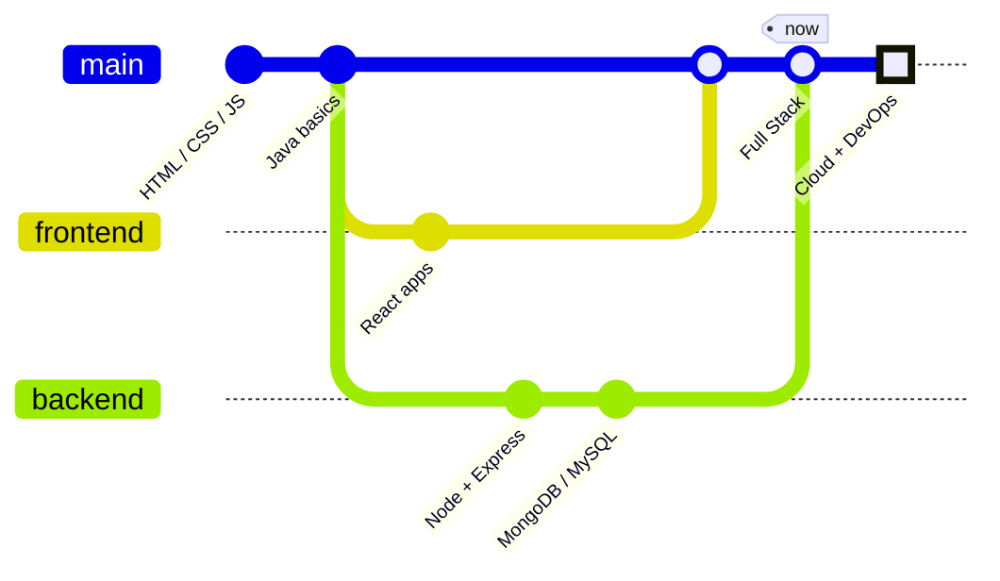

<div align="center">


<br/>


</div>

---

### 🖥️ `~/about.json`

```json
{
  "name": "Hemant Maurya",
  "role": "Full Stack Developer",
  "university": "Vivekananda Global University (VGU)",
  "currently_learning": ["React", "Node.js", "Java", "Web Design"],
  "ask_me_about": ["Web Development", "Java", "UI/UX Design"],
  "open_to": ["collaboration", "open-source", "freelance"],
  "fun_fact": "compiles faster with music on 🎧",
  "contact": "hemantjimi@gmail.com"
}
```

### ⚙️ `~/stack.sh`

```bash
#!/usr/bin/env bash
LANGUAGES=("Java" "JavaScript" "Python" "HTML5" "CSS3")
FRONTEND=("React" "Bootstrap" "Tailwind")
BACKEND=("Node.js" "Express")
DATABASES=("MongoDB" "MySQL")
TOOLS=("Git" "GitHub" "VS Code" "Postman" "Figma")
```

<div align="center">

<br/>


</div>

---

### 📈 `$ npm run stats`

<div align="center">


<br/><br/>


</div>

---

### 🧊 `render --3d contributions`

<div align="center">

</div>

### 🐍 `snake --eat contributions`

<div align="center">
<picture>
  <source media="(prefers-color-scheme: dark)" srcset="https://raw.githubusercontent.com/HemantJimin/HemantJimin/output/snake-dark.svg">
  <source media="(prefers-color-scheme: light)" srcset="https://raw.githubusercontent.com/HemantJimin/HemantJimin/output/snake.svg">
  
</picture>
</div>

---

### 🚀 `ls ~/projects`

<div align="center">

<a href="https://github.com/HemantJimin/YOUR-REPO-1"></a>
<a href="https://github.com/HemantJimin/YOUR-REPO-2"></a>

</div>

> Replace `YOUR-REPO-1` and `YOUR-REPO-2` with your best repositories.

---

### 🗺️ `git log --oneline --graph`



---

### 🕹️ `./play --break-time`

<div align="center">

[](https://tetris.com/play-tetris)
[](https://play2048.co/)
[](https://www.crazygames.com/)

</div>

---

### 📡 `ping hemant`

<div align="center">

[](mailto:hemantjimi@gmail.com)
[](https://github.com/HemantJimin)
[](https://www.instagram.com/hemantjimin/)
[](http://webdevsoft.com/)

<br/>


</div>


