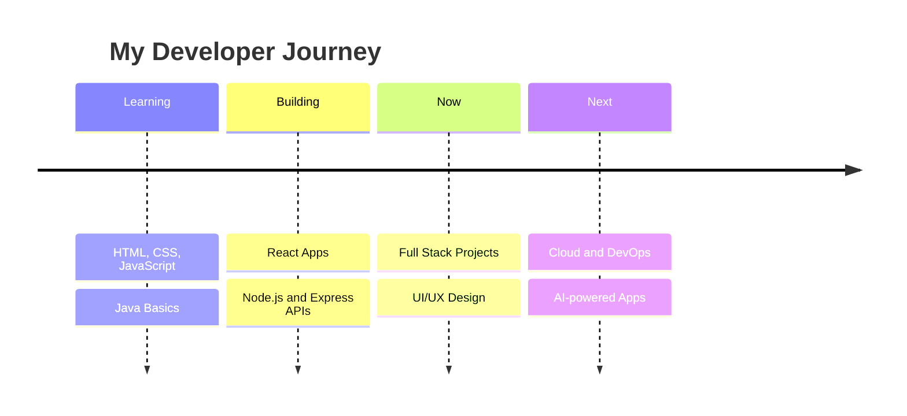

<!-- ===================== HERO BANNER (animated waving + 3D shadow text) ===================== -->
<div align="center">


<a href="https://github.com/HemantJimin">
  
</a>

<br/>


</div>

<br/>

---

## 👨‍💻 About Me

<table>
<tr>
<td width="60%">

```js
const hemant = {
  name: "Hemant Maurya",
  role: "Full Stack Developer",
  education: "Vivekananda Global University (VGU)",
  currentlyLearning: ["React", "Node.js", "Java", "Web Design"],
  askMeAbout: ["Web Development", "Java", "UI/UX Design"],
  funFact: "I code best with music on 🎧",
  email: "hemantjimi@gmail.com",
  motto: "Ship it. Learn. Repeat. 🔁"
};
```

</td>
<td width="40%" align="center">


</td>
</tr>
</table>

---

## 🛠️ Tech Stack

<div align="center">


<br/>


<br/><br/>


</div>

---

## 📊 GitHub Stats

<div align="center">


<br/>


<br/><br/>


</div>

---

## 🧊 3D Contribution Calendar

<div align="center">

<!-- Generated by the GitHub Action in .github/workflows/profile-3d.yml -->


</div>

---

## 🐍 Snake Game: Watch it Eat My Contributions

<div align="center">

<picture>
  <source media="(prefers-color-scheme: dark)" srcset="https://raw.githubusercontent.com/HemantJimin/HemantJimin/output/github-contribution-grid-snake-dark.svg">
  <source media="(prefers-color-scheme: light)" srcset="https://raw.githubusercontent.com/HemantJimin/HemantJimin/output/github-contribution-grid-snake.svg">
  
</picture>

</div>

---

## 🚀 Featured Projects

<div align="center">

<a href="https://github.com/HemantJimin/YOUR-REPO-1"></a>
<a href="https://github.com/HemantJimin/YOUR-REPO-2"></a>

<sub>Replace <code>YOUR-REPO-1</code> / <code>YOUR-REPO-2</code> with your best repositories.</sub>

</div>

---

## 🗺️ Roadmap



---

## 🕹️ Game Zone

<div align="center">

<a href="https://tetris.com/play-tetris"></a>
<a href="https://play2048.co/"></a>
<a href="https://www.crazygames.com/"></a>

</div>

---

## 🌐 Let's Connect

<div align="center">

<a href="mailto:hemantjimi@gmail.com"></a>
<a href="https://github.com/HemantJimin"></a>
<a href="https://www.instagram.com/hemantjimin/"></a>
<a href="http://webdevsoft.com/"></a>

<br/><br/>


<br/>


</div>


