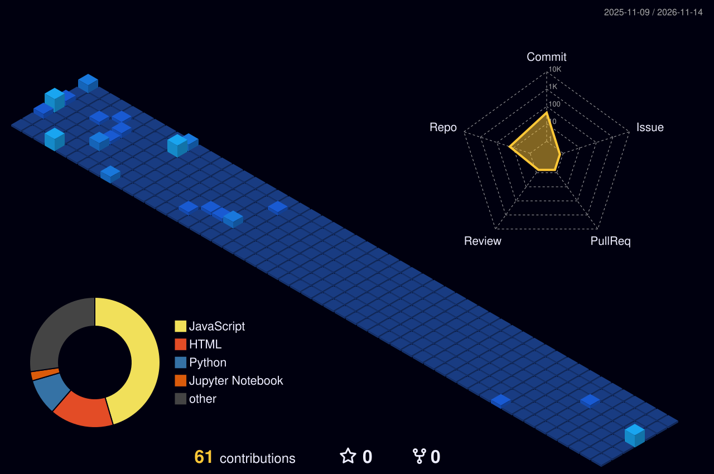
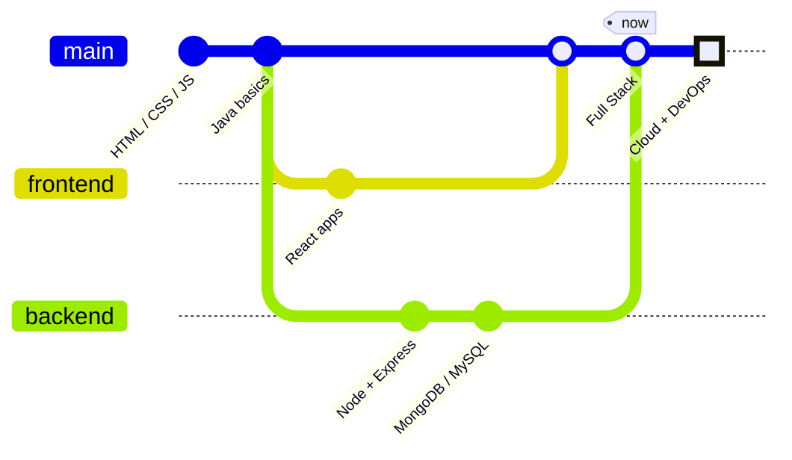

<div align="center">


<br/>


</div>

---

## 🖥️ about.json

```json
{
  "name": "Hemant Maurya",
  "role": "Full Stack Developer",
  "university": "Vivekananda Global University (VGU)",
  "currently_learning": ["React", "Node.js", "Java", "Web Design"],
  "ask_me_about": ["Web Development", "Java", "UI/UX Design"],
  "open_to": ["collaboration", "open-source", "freelance"],
  "fun_fact": "codes best with music on",
  "contact": "hemantjimi@gmail.com"
}
```

## ⚙️ Tech Stack

<div align="center">


<br/>


</div>

---

## 📈 Stats (auto-generated, animated)

<div align="center">



</div>

## 🧊 3D Contribution Calendar

<div align="center">



</div>

## 🐍 Snake vs My Contributions

<div align="center">

<picture>
  <source media="(prefers-color-scheme: dark)" srcset="https://raw.githubusercontent.com/HemantJimin/HemantJimin/output/snake-dark.svg">
  <source media="(prefers-color-scheme: light)" srcset="https://raw.githubusercontent.com/HemantJimin/HemantJimin/output/snake.svg">
  
</picture>

</div>

---

## 🚀 Projects

| Project | What it does | Stack |
| :-- | :-- | :-- |
| [**YOUR-REPO-1**](https://github.com/HemantJimin/YOUR-REPO-1) | One line about this project | `React` `Node.js` |
| [**YOUR-REPO-2**](https://github.com/HemantJimin/YOUR-REPO-2) | One line about this project | `Java` `MySQL` |

## 🗺️ Journey



---

## 🕹️ Break Time

<div align="center">

[](https://tetris.com/play-tetris)
[](https://play2048.co/)
[](https://www.crazygames.com/)

</div>

## 📡 Connect

<div align="center">

[](mailto:hemantjimi@gmail.com)
[](https://github.com/HemantJimin)
[](https://www.instagram.com/hemantjimin/)
[](http://webdevsoft.com/)

<sub><i>"Code is like humor. When you have to explain it, it's bad." - Cory House</i></sub>

</div>


